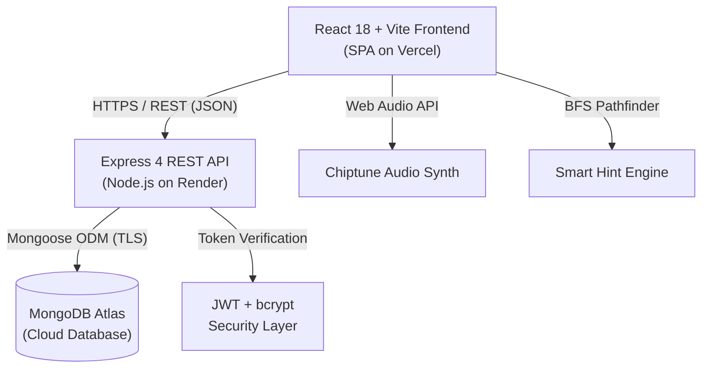

# 🍎🐛 Apple Worm Adventure — Retro Arcade Edition

> **A full-stack, retro-arcade puzzle platformer featuring 50 hand-crafted levels, authoritative physics, cloud progress synchronization, tokenized in-game economy (VELoop Coins), competitive leaderboards, achievements, and an administrative control suite.**

---

## 📑 Table of Contents

1. [Project Overview](#1-project-overview)
2. [Architecture Overview](#2-architecture-overview)
3. [Technology Stack](#3-technology-stack)
4. [Core Features](#4-core-features)
5. [Level Design & Five Themed Worlds](#5-level-design--five-themed-worlds)
6. [Game Mechanics & Physics](#6-game-mechanics--physics)
7. [Visual Design & Retro Arcade Theme](#7-visual-design--retro-arcade-theme)
8. [Screenshots & UI Walkthrough](#8-screenshots--ui-walkthrough)
9. [Live Deployment Links](#9-live-deployment-links)
10. [Local Setup Guide](#10-local-setup-guide)
11. [Environment Variable Configuration](#11-environment-variable-configuration)
12. [Database Setup & Atlas Configuration](#12-database-setup--atlas-configuration)
13. [Seeding Demo Data](#13-seeding-demo-data)
14. [Demo Credentials](#14-demo-credentials)
15. [Testing & Quality Assurance](#15-testing--quality-assurance)
16. [REST API Documentation Summary](#16-rest-api-documentation-summary)
17. [Security & Authorization](#17-security--authorization)
18. [Economy & Rewards System](#18-economy--rewards-system)
19. [Leaderboard & Achievements System](#19-leaderboard--achievements-system)
20. [Admin Dashboard Capabilities](#20-admin-dashboard-capabilities)
21. [Responsive & Accessibility Features](#21-responsive--accessibility-features)
22. [Frontend Deployment Guide (Vercel)](#22-frontend-deployment-guide-vercel)
23. [Backend Deployment Guide (Render)](#23-backend-deployment-guide-render)
24. [Troubleshooting & FAQ](#24-troubleshooting--faq)
25. [Project Structure / Folder Hierarchy](#25-project-structure--folder-hierarchy)
26. [Known Limitations & Future Roadmap](#26-known-limitations--future-roadmap)
27. [Documentation Directory](#27-documentation-directory)
28. [Authors, Acknowledgments & License](#28-authors-acknowledgments--license)

---

## 1. Project Overview

**Apple Worm Adventure** is a full-stack puzzle platformer developed as a comprehensive engineering demonstration for the VELoop Rewards Developer Assignment. Inspired by classic grid-puzzle arcade titles, players control an expanding worm navigating tight mazes, consuming apples to grow, dodging traps, and entering dimension portals within strict move limits.

The project demonstrates production-grade full-stack engineering:
* **Deterministic Client Engine:** Real-time segmented worm physics, BFS smart pathfinding, and Web Audio chiptune synthesis.
* **Authoritative Cloud Backend:** Node.js/Express server backed by MongoDB Atlas managing player progress, session history, and an auditable virtual economy.
* **Modern Retro Arcade Aesthetic:** Immersive CRT scanline filters, arcade marquee HUDs, symmetrical responsive dashboards, and tactile controls.

---

## 2. Architecture Overview

Apple Worm Adventure follows a decoupled client-server architecture:



* **Client Layer:** Single-Page Application (SPA) powered by React 18, React Router 7, and Vite. Implements modular state contexts (`AuthContext`, `GameContext`), interactive canvas/grid components, and zero-dependency audio synthesis.
* **Server Layer:** Express REST API enforcing input validation, token verification, role-based authorization, rate limiting, and business logic.
* **Data Layer:** MongoDB Atlas with Mongoose ODM utilizing schema-level indexes for optimized game sessions, transaction ledgers, and leaderboard queries.

---

## 3. Technology Stack

| Layer | Technologies |
| :--- | :--- |
| **Frontend** | React 18.3, React Router 7, Vite 5, Modern CSS Design Tokens, Web Audio API |
| **Backend** | Node.js (LTS), Express 4.21, CORS, dotenv |
| **Database & ODM** | MongoDB Atlas (Replica Set), Mongoose 9.11 |
| **Authentication** | JSON Web Tokens (`jsonwebtoken`), `bcryptjs` (10 salt rounds) |
| **Testing** | Node.js Test Runner, Custom QA Verification Suites (119 Automated Tests) |
| **DevOps & Hosting** | Vercel (Frontend SPA), Render / Railway (Backend API), Git |

---

## 4. Core Features

* **50 Puzzle Levels Across 5 Worlds:** Fully playable campaign with progressive difficulty and move budgets.
* **Arcade Cabinet Experience:** CRT monitor scanlines, LED indicators, pixel marquee, chiptune audio, and physical 3D push-buttons.
* **Undo & Smart BFS Hints:** Snapshot state stack allows infinite step undos; BFS pathfinder reveals optimal moves.
* **Dual Input System:** Seamless support for physical keyboards (Arrow Keys, WASD) and touch-screen arcade D-Pads.
* **Cloud Progress Synchronization:** Instant persistence of stars, best scores, completed stages, and unlocks to MongoDB Atlas.
* **VELoop Coin Economy:** Authoritative balance, immutable transaction ledger, daily earn caps, and booster store.
* **In-Game Booster Store:** Buy Extra Moves (+5), Smart Hints, Revive Tokens, and Double Score Boosts.
* **Simulated Rewarded Ads:** Mock video ad system granting coin bonuses with client countdowns and server-side cooldowns.
* **Global Leaderboards:** Filterable high scores across all levels or individual stages (1–50).
* **Player Dashboard & Achievements:** Symmetrical 3x2 metric cards grid, player profile, and 10 dynamic trophy badges.
* **Admin Control Panel:** Live system analytics, player role management, and real-time economy parameter tuning.

---

## 5. Level Design & Five Themed Worlds

| World | Name | Level Range | Difficulty | Core Mechanics & Characteristics |
| :---: | :--- | :---: | :---: | :--- |
| **1** | **Sunny Orchard** | Levels 1–10 | Easy | Open pathways, single apples, introducing worm turning and portal navigation. |
| **2** | **Stone Hollows** | Levels 11–20 | Medium | Narrow stone corridors, 2–3 apples, body trapping hazards, cornering puzzles. |
| **3** | **Bramble Valley** | Levels 21–30 | Med-Hard | Thorny barriers, tight choke points, growth sequence management. |
| **4** | **Gravity Caverns** | Levels 31–40 | Hard | Ledges, drop-offs, platform balancing, gravity-assisted slithering. |
| **5** | **King's Citadel** | Levels 41–50 | Expert | Multi-stage labyrinths, 4+ apples, razor-thin move limits for 3-star mastery. |

---

## 6. Game Mechanics & Physics

* **Segmented Worm Body:** The worm is composed of an ordered list of coordinate segments `[(x0, y0), (x1, y1), ...]`. When the head moves, each following segment occupies the former position of its predecessor.
* **Apple Consumption & Growth:** Colliding with an apple consumes it, plays an eating chime, increments the apple counter, and extends the worm tail by +1 segment without moving the tail forward on that step.
* **Collision Detection:** The worm cannot pass through solid walls or its own body. Attempting an invalid move triggers audio buzzer feedback and halts movement without consuming moves.
* **Move Budgets & Stars:** Each level defines a `maxMoves` budget. Levels award:
  * **3 Stars:** Completed within optimal move threshold ($\le 1.25\times \text{par}$).
  * **2 Stars:** Completed within intermediate move threshold ($\le 1.6\times \text{par}$).
  * **1 Star:** Completed before exhausting remaining moves.
* **Scoring Formula:**
  $$\text{Score} = (\text{Apples Eaten} \times 250) + (\text{Remaining Moves} \times 50) + (\text{Stars} \times 200)$$
  *(Multiplied by $2\times$ when Double Score Boost is active).*

---

## 7. Visual Design & Retro Arcade Theme

* **Color Palette:**
  * Background: Deep Navy (`#070b18` & `#0a1022`)
  * Bezel / Accent Borders: Subtle Blue-Gray (`#1a263f` & `#334155`)
  * Neon Accents: Slime Green (`#00ff66`), Warm Amber (`#ffb703`), Coral Red (`#ff3366`), Cyan (`#00f0ff`)
* **Typography:**
  * Titles & Arcade Headers: `'Press Start 2P'`, monospace
  * UI, Labels & Navigation: `'Chakra Petch'`, sans-serif
  * HUD Digits & Counters: `'VT323'`, monospace
* **CRT Overlay:** Pure CSS scanlines and radial vignette simulating genuine 1980s arcade monitor phosphors without performance impact.

---

## 8. Screenshots & UI Walkthrough

| Screen | Description |
| :--- | :--- |
| **Arcade Gameplay** | CRT screen cabinet with pixel marquee, digital LED HUD, grid canvas, and physical control deck. |
| **Level Select** | Clean retro layout, 3-metric progress summary (Completed, Stars, Unlocked), numeric world tabs (1–10, 11–20), and 4-column level cards. |
| **Player Dashboard** | Profile banner, quick continue button, symmetrical 3x2 metric cards grid, and 10 dynamic trophy badges. |
| **Rewards & Boosters** | Clean wallet summary card, active balance, daily earn progress track, and 4 in-game boosters. |
| **Global Leaderboard** | Filterable high-score table displaying player rank, level, moves, stars, and total score. |
| **Admin Control Suite** | Metric cards grid, player management table with role toggles, and live economy configuration sliders. |

---

## 9. Live Deployment Links

* **Frontend Web Application (Vercel):** `https://apple-worm-adventure.vercel.app` *(or custom Vercel domain)*
* **Backend REST API (Render):** `https://apple-worm-adventure-api.onrender.com`
* **API Health Check Endpoint:** `https://apple-worm-adventure-api.onrender.com/api/health`

---

## 10. Local Setup Guide

### Prerequisites
* **Node.js:** v18.0.0 or higher
* **npm:** v9.0.0 or higher
* **MongoDB:** Free MongoDB Atlas cluster or local MongoDB instance

### Step-by-Step Installation

```bash
# 1. Clone repository
git clone https://github.com/your-username/Apple-Worm-Adventure.git
cd Apple-Worm-Adventure

# 2. Setup Server
cd server
npm install
cp .env.example .env
# Edit server/.env with your real MongoDB Atlas connection string and JWT_SECRET

# 3. Setup Client
cd ../client
npm install
cp .env.example .env
# Client defaults to VITE_API_URL=http://localhost:5000/api

# 4. Seed Database (From server directory)
cd ../server
npm run seed:all

# 5. Launch Servers
# Terminal 1 (Backend):
npm run dev

# Terminal 2 (Frontend):
cd ../client
npm run dev
```

Open your browser at `http://localhost:5173`.

---

## 11. Environment Variable Configuration

### Backend (`server/.env`)
| Variable | Example Value | Description |
| :--- | :--- | :--- |
| `PORT` | `5000` | Port for Express HTTP server |
| `MONGODB_URI` | `mongodb+srv://...` | MongoDB Atlas replica set connection string |
| `DB_NAME` | `apple_worm_adventure` | Name of the database |
| `JWT_SECRET` | `secret_key_32_characters` | Secret key used to sign and verify JWT tokens |
| `CLIENT_URL` | `http://localhost:5173` | Allowed CORS frontend origin |
| `FRONTEND_URL` | `http://localhost:5173` | Secondary CORS origin |
| `GAME_NAME` | `Apple Worm Adventure` | Game branding string |
| `NODE_ENV` | `development` | Environment mode (`development` / `production`) |

### Frontend (`client/.env`)
| Variable | Example Value | Description |
| :--- | :--- | :--- |
| `VITE_API_URL` | `http://localhost:5000/api` | Backend API base URL |
| `VITE_GAME_NAME` | `Apple Worm Adventure` | Client display name |

---

## 12. Database Setup & Atlas Configuration

1. Create a free **M0 Sandbox** cluster on [MongoDB Cloud](https://cloud.mongodb.com/).
2. Create a database user with `readWriteAnyDatabase` permissions.
3. In **Network Access**, add `0.0.0.0/0` to permit connections from deployment platforms (Render/Vercel).
4. Copy the connection string into `server/.env` under `MONGODB_URI`.

---

## 13. Seeding Demo Data

The project includes an idempotent master seed script:

```bash
cd server
npm run seed:all
```

This automatically:
1. Seeds all 50 Levels into the `levels` collection with validated puzzles.
2. Seeds 10 system achievements into the `achievements` collection.
3. Seeds a ready-to-test **Demo Player** with 5 completed levels, 14 stars, and 350 VELoop coins.
4. Seeds a ready-to-test **Administrator** account with full control privileges.

---

## 14. Demo Credentials

| Role | Email | Password | Pre-configured State |
| :--- | :--- | :--- | :--- |
| **Demo Player** | `demo@appleworm.dev` | `DemoPassword123!` | 5 Levels Completed, Level 6 Unlocked, 14 Stars, 350 Coins |
| **Administrator** | `admin@appleworm.dev` | `AdminPassword123!` | Full Admin Panel Access, Economy Sliders, User Management |

---

## 15. Testing & Quality Assurance

Apple Worm Adventure includes comprehensive automated test suites:

```bash
# Run complete Phase 10 verification suite
node scratch/test-phase10-audit.js

# Run all test suites
node scratch/test-phase10-audit.js
node scratch/test-level-select-redesign.js
node scratch/test-rewards-and-dashboards-simplification.js
node scratch/test-collapsible-cards.js
node scratch/test-register-page.js
```

### Verified QA Statistics:
* **Total Automated Tests:** 119 / 119 Passed (100%)
* **Production Build:** Vite built in 1.37s with 0 errors and 0 warnings.
* **Full Report:** See [docs/TESTING_REPORT.md](docs/TESTING_REPORT.md).

---

## 16. REST API Documentation Summary

| Method | Endpoint | Access | Purpose |
| :--- | :--- | :---: | :--- |
| `GET` | `/api/health` | Public | Server and MongoDB connection health check |
| `POST` | `/api/auth/register` | Public | Register new player with starting bonus (200 coins) |
| `POST` | `/api/auth/login` | Public | Authenticate player and receive JWT token |
| `GET` | `/api/auth/me` | Private | Retrieve authenticated user profile and balance |
| `GET` | `/api/progress` | Private | Fetch player unlocked levels, stars, and stats |
| `POST` | `/api/progress/complete` | Private | Authoritative level completion and progress sync |
| `GET` | `/api/levels` | Public | Fetch all 50 level definitions |
| `GET` | `/api/wallet/balance` | Private | Fetch wallet balance and daily earn progress |
| `POST` | `/api/wallet/purchase-booster` | Private | Buy in-game booster with VELoop coins |
| `GET` | `/api/wallet/transactions` | Private | Fetch immutable audit ledger of reward transactions |
| `POST` | `/api/rewards/claim-daily` | Private | Claim daily check-in bonus (+25 coins) |
| `POST` | `/api/rewards/claim-ad` | Private | Claim simulated rewarded video bonus (+50 coins) |
| `GET` | `/api/leaderboard` | Public | Fetch global high scores |
| `GET` | `/api/achievements` | Private | Fetch achievements and unlock status |
| `GET` | `/api/admin/stats` | Admin | Fetch system analytics |
| `GET` | `/api/economy/config` | Admin | Read economy configuration parameters |
| `PUT` | `/api/economy/config` | Admin | Update daily earn caps and booster costs |

*Full endpoint documentation:* See [docs/API_DOCUMENTATION.md](docs/API_DOCUMENTATION.md).

---

## 17. Security & Authorization

1. **Password Hashing:** Stored using `bcryptjs` with 10 salt rounds; plaintext passwords never touch the database.
2. **JWT Authentication:** Cryptographically signed tokens carrying a 7-day expiration time.
3. **Role-Based Access Control (RBAC):** Middleware (`authMiddleware.js`) and React route guards (`AdminRoute.jsx`) prevent unauthorized access to administrative functions.
4. **Authoritative Server Validation:** Score submissions, reward grants, and booster transactions are verified server-side.
5. **CORS Security:** Cross-origin requests are restricted to explicit whitelisted origins, localhost, and Vercel domains.
6. **Zero Secrets in Git:** Root `.gitignore` prevents `.env` and local credentials from ever being staged.

---

## 18. Economy & Rewards System

The in-game economy is powered by **VELoop Coins ($\text{VC}$)**:
* **Starting Bonus:** 200 VC upon registration.
* **Level First Clear:** 50 VC.
* **3-Star Mastery:** 25 VC.
* **Daily Check-In:** 25 VC.
* **Daily Earn Cap:** Configurable ceiling (default: 500 VC/day) preventing runaway token inflation.
* **Booster Store:**
  * Extra Moves (+5): 50 VC
  * Smart BFS Hint: 40 VC
  * Revive Token: 75 VC
  * Double Score Boost: 60 VC

---

## 19. Leaderboard & Achievements System

* **Global Leaderboard:** Ranks players across levels based on score, moves taken, and stars earned.
* **Achievements Showcase:** 10 tiered milestones including *First Apple*, *Getting Started*, *Puzzle Explorer*, *Halfway Hero*, *Apple Worm Grandmaster*, and *Constellation Master*.

---

## 20. Admin Dashboard Capabilities

Accessible exclusively to users with `role: "admin"` at `/admin`:
* **System Metrics:** Registered players count, total puzzles cleared, total stars awarded, circulating coins.
* **Economy Controls:** Live sliders to modify daily earn caps, booster costs, and reward multipliers.
* **Player Management:** Search and filter players, view wallet balances, and toggle administrator privileges.

---

## 21. Responsive & Accessibility Features

* **Responsive Layouts:** Desktop 4-column level grid gracefully adapts to 3 columns on tablets and 2 columns on mobile.
* **Touch Arcade D-Pad:** Virtual 4-way direction pad with tactile visual response for mobile and tablet players.
* **High Contrast:** All text meets WCAG AA contrast criteria over dark navy surfaces.
* **Keyboard Navigation:** Full support for Arrow keys, WASD, Enter, Spacebar, and Tab navigation.

---

## 22. Frontend Deployment Guide (Vercel)

1. Connect repository to [Vercel](https://vercel.com/).
2. Set Root Directory to `client`.
3. Set Framework to `Vite`.
4. Configure Environment Variables:
   * `VITE_API_URL` = `https://<your-backend>.onrender.com/api`
   * `VITE_GAME_NAME` = `Apple Worm Adventure`
5. Deploy. `client/vercel.json` automatically ensures SPA rewrite rules prevent 404s on page reloads.

---

## 23. Backend Deployment Guide (Render)

1. Create a new **Web Service** on [Render](https://render.com/).
2. Set Root Directory to `server`.
3. Build Command: `npm install`
4. Start Command: `npm start`
5. Configure Environment Variables (`NODE_ENV`, `PORT`, `MONGODB_URI`, `JWT_SECRET`, `CLIENT_URL`).
6. Deploy and verify health at `/api/health`.

*Detailed step-by-step instructions:* See [docs/DEPLOYMENT.md](docs/DEPLOYMENT.md).

---

## 24. Troubleshooting & FAQ

**Q: Refreshing a page on Vercel returns 404 Not Found.**
> A: Ensure `vercel.json` is present with the SPA rewrite rule `{ "source": "/(.*)", "destination": "/index.html" }`. This is already configured in both `client/vercel.json` and the project root.

**Q: Backend logs show `MONGODB_URI contains placeholder credentials`.**
> A: Replace `<username>` and `<password>` in `server/.env` with your real MongoDB Atlas database user credentials.

**Q: How do I promote a user to administrator?**
> A: Run `node src/scripts/createAdmin.js promote <email>` from the `server` directory, or run `npm run seed:all` to provision the default administrator.

---

## 25. Project Structure / Folder Hierarchy

```
Apple-Worm-Adventure/
├── client/                     # Frontend Single Page Application
│   ├── public/                 # Static assets, favicon, chiptune sounds
│   ├── src/
│   │   ├── components/         # Reusable UI, Layout, Game, & Auth components
│   │   │   ├── auth/           # ProtectedRoute, AdminRoute
│   │   │   ├── game/           # ArcadeCabinet, GameBoard, GameDPad, Controls
│   │   │   ├── layout/         # Navbar, Footer
│   │   │   └── ui/             # Card, Button, Badge, Modal
│   │   ├── config/             # API client & game constants
│   │   ├── context/            # AuthContext, GameContext
│   │   ├── data/               # Levels dataset & mock state
│   │   ├── gameEngine/         # GameEngine, useGameEngine, solver, soundEffects
│   │   ├── pages/              # Home, Levels, Game, Leaderboard, Wallet, Dashboard, Admin
│   │   ├── App.jsx             # React Router routing configuration
│   │   └── main.jsx            # React root mount point
│   ├── .env.example            # Client environment template
│   ├── package.json            # Client dependencies & Vite scripts
│   ├── vercel.json             # Vercel SPA rewrites
│   └── vite.config.js          # Vite bundler configuration
│
├── server/                     # Backend REST API Server
│   ├── src/
│   │   ├── config/             # Database connection, seed levels & achievements
│   │   ├── controllers/        # Express route handler logic (10 controllers)
│   │   ├── middleware/         # Auth verification & admin gatekeeping
│   │   ├── models/             # 8 Mongoose schemas (User, Progress, Wallet, etc.)
│   │   ├── routes/             # Express API route declarations
│   │   ├── scripts/            # Admin creator & master demo seed scripts
│   │   ├── utils/              # JWT generator & helpers
│   │   └── index.js            # Express entry point, CORS, and health checks
│   ├── .env.example            # Server environment template
│   └── package.json            # Server dependencies & scripts
│
├── docs/                       # Comprehensive Technical Documentation
│   ├── FEATURES.md             # Complete feature matrix & game worlds breakdown
│   ├── API_DOCUMENTATION.md    # Full REST endpoint reference & schemas
│   ├── DEPLOYMENT.md           # Step-by-step production deployment guide
│   └── TESTING_REPORT.md       # QA report with 119 automated test results
│
├── scratch/                    # Automated QA and audit test suites
├── .env.example                # Root project environment reference
├── .gitignore                  # Git exclusions (credentials, node_modules, dist)
├── vercel.json                 # Monorepo Vercel deployment configuration
└── README.md                   # Master project documentation
```

---

## 26. Known Limitations & Future Roadmap

* **Replica Set Transactions:** In standalone MongoDB deployments without a replica set, atomic multi-document transactions fall back to sequential validation. Upgrading to a MongoDB Atlas cluster provides full multi-document ACID transactions.
* **Future Roadmap:**
  * Custom community level editor and sharing portal.
  * Real-time 2-player competitive race mode via WebSockets.
  * Additional puzzle worlds (Volcano Peaks, Cyber Matrix).
  * Web3 wallet export for VELoop rewards tokens.

---

## 27. Documentation Directory

For in-depth technical documentation, refer to:
* 🌟 [Full Feature Matrix (`docs/FEATURES.md`)](docs/FEATURES.md)
* 📡 [REST API Specification (`docs/API_DOCUMENTATION.md`)](docs/API_DOCUMENTATION.md)
* 🚀 [Production Deployment Guide (`docs/DEPLOYMENT.md`)](docs/DEPLOYMENT.md)
* 🧪 [QA & Automated Test Report (`docs/TESTING_REPORT.md`)](docs/TESTING_REPORT.md)

---

## 28. Authors, Acknowledgments & License

* **Project:** Apple Worm Adventure (Retro Arcade Edition)
* **Author:** Prathamesh Deodhagle
* **Assignment:** VELoop Rewards Full Stack Developer Evaluation
* **Inspiration:** Classic Apple Worm & 1980s Retro Arcade Cabinets
* **License:** [MIT License](LICENSE)
